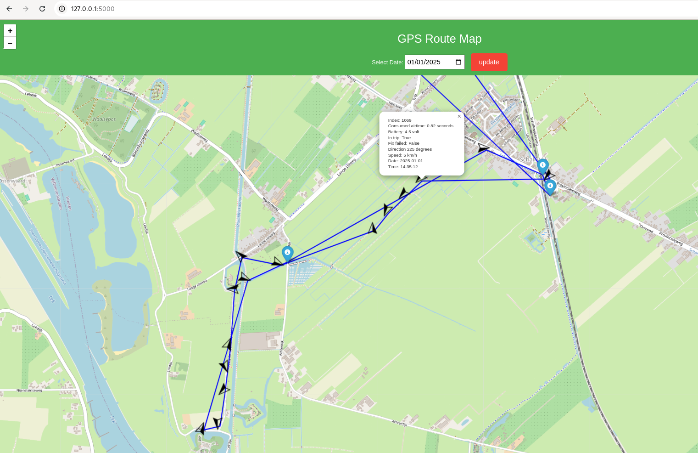

# Oyster3-lorawan GPS tracker

This project is designed to help you seamlessly integrate and utilize the Digital Matter Oyster3 GPS tracker with The Things Network (TTN). The Oyster3 is a robust, low-power, and highly accurate GPS tracking device, making it ideal for a wide range of IoT applications, including asset tracking, fleet management, and environmental monitoring.

This repository provides a comprehensive guide and resources for configuring the Oyster3 GPS tracker, decoding its payloads, and leveraging TTN for data transmission and visualization. Whether you're an IoT enthusiast, a developer, or a company looking to deploy a scalable GPS tracking solution, this project will help you get started quickly and effectively.

### Features

* Device Configuration: Script to configure the Oyster 3 device using Lorawan Downlinks (No additional software and hardware required).
* Visualization: local webserver that plots the GPS track on OpenStreetMap, with a date/time range selector.
* Payload Encoding/Decoding: uplink decoders and downlink encoder that follow the Digital Matter Oyster 3 LoRaWAN Integration spec (rev. 1.3), with tests based on the examples in that spec.
* TTN Integration: guide for connecting your tracker to The Things Stack / The Things Network, and a local copy of your data.
* Should be compatible with the previous model, the Oyster LoRaWAN. Not tested. Check the documentation!

## Scripts

### Requirements

Important: set up the Oyster 3 device in The Things Stack first: https://support.digitalmatter.com/351-setup-devices-on-the-things-network-v3

The scripts use The Things Stack Cloud (`<tenant>.<region>.cloud.thethings.industries`). Its *Discovery* plan is free for up to 10 devices: https://www.thethingsindustries.com/the-things-stack/pricing

Configure your own TTN settings via environment variables. Copy the example file, fill in your values and load it:
````bash
$ cp export-env-vars.sh.example export-env-vars.sh
$ chmod 600 export-env-vars.sh      # the file contains API keys; it is ignored by git
$ . ./export-env-vars.sh
````

| Variable | Meaning |
|---|---|
| `TTN_DEVICE` | TTN end device id |
| `TTN_APPLICATION` | TTN application id |
| `TTN_REGION` | Cluster region of your console, e.g. `eu1` |
| `TTN_CONSOLE` | Tenant / console name |
| `TTN_API_KEY` | API key used to read the Storage Integration |
| `TTN_DOWNLINK_API_KEY` | Optional API key used only to send downlinks (falls back to `TTN_API_KEY`) |
| `TTN_NUMBER_OF_RECORDS` | Maximum records per request, `0` = no limit |
| `TTN_SINCE_DATE_TIME` | Start of the first fetch, e.g. `2024-11-21T10:00:00Z` |

API keys:
* Give the key in `TTN_API_KEY` only the right `RIGHT_APPLICATION_TRAFFIC_READ`. The webserver and the fetch/ack scripts never need more.
* Create a separate key with downlink (traffic write) rights for `TTN_DOWNLINK_API_KEY`, and only load it when you configure the device.
* Keep `export-env-vars.sh` private (`chmod 600`). If the file was ever shared or committed, revoke the keys in the TTN Console and create new ones.

Install the dependencies (Python 3.10 or newer):
````bash
$ python -m venv .venv && . .venv/bin/activate
$ pip install -r requirements.txt
````

### Run webserver with tracking marker on Open Streetmap

The webserver.py script is a lightweight, local web server (Flask & Folium) that shows the GPS data of the Oyster3 LoRaWAN GPS Tracker on OpenStreetMap. Select a start and end date/time (in your local time zone, `APP_TIMEZONE`, default `Europe/Amsterdam`) and which locations to show (stopped / in trip, fix successful / fix failed).

The map is drawn from the local database (see *Keep a local copy of your data* below); opening the page never contacts TTN. Press *fetch new data from TTN* to fetch new uplinks first. Only GNSS position uplinks (ports 1, 4 and 33) are plotted. Markers: green = stopped, blue = in trip without speed, arrow = direction of travel, red = the fix failed and the device repeated its previous (cached) position; red markers are not part of the route line.

Start the webserver:
````bash
$ python ./webserver.py
````
View in the webbrowser: http://localhost:5000

By default the webserver only listens on `127.0.0.1` and the Flask debugger is off. You can change this with `APP_HOST`, `APP_PORT` and `APP_DEBUG=1`, but never enable the debugger on a host that others can reach: it allows arbitrary code execution. Do not open the port in your firewall. If you need access from other machines, run the app with a production WSGI server (for example gunicorn or waitress) behind a reverse proxy with authentication.



### Keep a local copy of your data

The Things Stack Cloud keeps uplinks in the Storage Integration for **30 days** (24 hours on The Things Stack Sandbox). Anything you have not fetched within that period is lost. `fetch.py` copies new uplinks into a local SQLite database (`data/uplinks.sqlite3`, readable only by you), asking only for uplinks after the newest one it already has. It is safe to run as often as you like.

````bash
$ python ./fetch.py                      # fetch new uplinks into data/uplinks.sqlite3
$ python ./fetch.py --export-tsv out.tsv # export everything as tab-separated values
$ python ./import-snapshots.py           # one-off: import old json/*.json snapshots
````

Run `fetch.py` at least once a day. With cron (`crontab -e`):
````
15 * * * * cd /path/to/oyster3-lorawan-gps-tracker-ttn && . ./export-env-vars.sh && .venv/bin/python fetch.py >> data/fetch.log 2>&1
````

Or with a systemd user timer, `~/.config/systemd/user/oyster3-fetch.service`:
````ini
[Unit]
Description=Fetch Oyster 3 uplinks from TTN

[Service]
Type=oneshot
WorkingDirectory=/path/to/oyster3-lorawan-gps-tracker-ttn
ExecStart=/bin/bash -c '. ./export-env-vars.sh && exec .venv/bin/python fetch.py'
````
and `~/.config/systemd/user/oyster3-fetch.timer`:
````ini
[Unit]
Description=Fetch Oyster 3 uplinks every hour

[Timer]
OnCalendar=hourly
Persistent=true

[Install]
WantedBy=timers.target
````
Enable it with `systemctl --user enable --now oyster3-fetch.timer`.

### Configure Oyster3-lorawan using downlinks

Configuring the Digital Matter Oyster3 LoRaWAN GPS Tracker involves sending downlink messages from your LoRaWAN network server, such as The Things Stack. Downlinks are used to update the device's settings remotely, enabling you to customize its behavior for specific use cases like asset tracking, fleet management, or environmental monitoring.

Set the values in [config.yaml](./config.yaml) for a particular downlink. The file ships with the factory defaults of the [Oyster 3 LoRaWAN Integration spec rev. 1.3](https://static.helpjuice.com/helpjuice_production/uploads/upload/image/14099/3479218/1694608512517-Oyster%2B3%2BLoRaWAN%2BIntegration%2B1.3.pdf); the script warns about every value that differs from its default, and refuses to build a payload when a value does not fit its field or falls outside the ranges recorded in `config.yaml` (`min`/`max`, or `allowed` for split ranges such as 1-127 / 129-255). Ranges that depend on another field are not checked, for example the poll period of downlink 35 (1-65535, but 0 is used together with poll count 0 to cancel polling): check those yourself in the dry-run table. Use a new sequence number for every attempt (`--sequencenumber`), so you can match the acknowledgement.

Be aware that some 'faulty' configuration changes on the downlink 7, 8 or 9 (all related to the LoRaWAN configuration) can make the device unreachable. However, all other 'faulty' configurations can be undone by applying the correct configuration.

Validate the output by running the configure-using-downlinks.py script without the `--send` option. Bit numbers count from the least significant bit (bit 0) of each byte, exactly as in the spec, and multi-byte fields are little-endian (the JoinEUI of downlink 8 is the only big-endian field):
````bash
$ python ./configure-using-downlinks.py --downlink 9
Send downlink: False
downlink9 Byte Array: 010711ff567f00

Bits are numbered from the least significant bit (bit 0) of each byte, as in the Digital Matter spec;
multi-byte fields are little-endian unless marked 'endian: big'. 'Field bits' is the value the device reads.

Downlink | Byte | Bit | Length | Type           | Value | Field bits (MSB..LSB) | Payload bytes | Description
========================================================================================================================================================================
9        | 0    | 0   | 7      | integer        | 1     | 0000001               | 01            | 0.0 - 0.6 Downlink sequence number (reported in acknowledgement)
------------------------------------------------------------------------------------------------------------------------------------------------------------------------
9        | 0    | 7   | 1      | boolean        | 0     | 0                     | 01            | 0.7 Reserved, set to zero
------------------------------------------------------------------------------------------------------------------------------------------------------------------------
9        | 1    | -   | 1      | integer        | 7     | 00000111              | 07            | 1 Days between network joins, 0 disables, default 7
------------------------------------------------------------------------------------------------------------------------------------------------------------------------
9        | 2    | 0   | 2      | integer        | 1     | 01                    | 11            | 2.0 - 2.1 ADR support, 0= Never, 1= When out-of-trip, 2= Always,
         |      |     |        |                |       |                       |               | default 1
------------------------------------------------------------------------------------------------------------------------------------------------------------------------
9        | 2    | 2   | 2      | integer        | 0     | 00                    | 11            | 2.2 - 2.3 Reserved, set to zero
------------------------------------------------------------------------------------------------------------------------------------------------------------------------
9        | 2    | 4   | 4      | integer        | 1     | 0001                  | 11            | 2.4 - 2.7 Initial frame repetitions (NbTrans/Reps), 1-15, default 1
------------------------------------------------------------------------------------------------------------------------------------------------------------------------
9        | 3    | 0   | 4      | integer        | 15    | 1111                  | ff            | 3.0 - 3.3 Initial MaxCount0, sets uplinks between Rejoin0 attempts in
         |      |     |        |                |       |                       |               | LoRaWAN 1.1 OTAA, uplink interval equals 2^(4+MaxCount0), default 15
------------------------------------------------------------------------------------------------------------------------------------------------------------------------
9        | 3    | 4   | 4      | integer        | 15    | 1111                  | ff            | 3.4 - 3.7 Initial MaxTime0, sets approx. time between Rejoin0 attempts
         |      |     |        |                |       |                       |               | in LoRaWAN 1.1 OTAA, uplink period equals 2^(10+MaxTime0) s, default
         |      |     |        |                |       |                       |               | 15
------------------------------------------------------------------------------------------------------------------------------------------------------------------------
9        | 4    | 0   | 4      | integer        | 6     | 0110                  | 56            | 4.0 - 4.3 Initial AdrAckLimitExp, sets uplinks between ADR
         |      |     |        |                |       |                       |               | confirmation requests, uplink interval equals 2^AdrAckLimitExp,
         |      |     |        |                |       |                       |               | default 6 (limit is 64)
------------------------------------------------------------------------------------------------------------------------------------------------------------------------
9        | 4    | 4   | 4      | integer        | 5     | 0101                  | 56            | 4.4 - 4.7 Initial AdrAckDelayExp, sets uplinks between ADR backoff
         |      |     |        |                |       |                       |               | steps, uplink interval equals 2^AdrAckDelayExp, default 5 (delay is
         |      |     |        |                |       |                       |               | 32)
------------------------------------------------------------------------------------------------------------------------------------------------------------------------
9        | 5    | -   | 1      | signed-integer | 127   | 01111111              | 7f            | 5 Maximum Tx power limit, signed, -128-127= -128 to 127 dBm EIRP,
         |      |     |        |                |       |                       |               | default 127 (no limit)
------------------------------------------------------------------------------------------------------------------------------------------------------------------------
9        | 6    | -   | 1      | integer        | 0     | 00000000              | 00            | 6 Random Tx delay, 0= disabled, 1-127= 1-127 seconds, 129-255= 1-127
         |      |     |        |                |       |                       |               | minutes, default disabled
------------------------------------------------------------------------------------------------------------------------------------------------------------------------
````

After validating the output, run it with the `--send` option and wait until the Oyster3 device confirms the configuration change. The script prints the same table, queues the downlink and then polls for the acknowledgement:
````bash
$ python ./configure-using-downlinks.py --downlink 9 --sequencenumber 3 --send
Send downlink: True
downlink9 Byte Array: 030711ff567f00
...
Downlink queued on port 9 with sequence number 3.
Waiting for the acknowledgement (Uplink 2). The device sends it once, with its next uplink, and the Storage Integration is not real-time, so this can take a while.
Attempt 1/60: no acknowledgement yet.
Attempt 2/60: no acknowledgement yet.
MATCH: received_at: 2026-01-05T13:56:56.256908+00:00, sequence number: 3, accepted: True, downlink_port_number: 9
````

How the acknowledgement works:
* The network delivers a queued downlink after the next uplink of the device. The device answers with a downlink acknowledgement (Uplink 2) **only once**, on its next uplink attempt; it reports the sequence number, whether the downlink was accepted and the downlink port.
* The Storage Integration writes uplinks in batches and is not meant for real-time use, so an acknowledgement can show up minutes later. Not getting one in time does not mean the configuration failed. If the uplink with the acknowledgement was lost, no acknowledgement will ever arrive: check the device behaviour (for example poll the statistics with downlink 35) or send the downlink again with a new sequence number.
* Use `--attempts` and `--interval` to change how long the script waits (default 60 attempts, 30 seconds apart).

Check acknowledgements later with ack.py. List every acknowledgement of the last 48 hours:
````bash
$ python ./ack.py --history --hours 48
received_at: 2026-01-04T20:56:24.896061+00:00, sequence number: 2, accepted: True, downlink_port_number: 9
received_at: 2026-01-05T13:56:56.256908+00:00, sequence number: 3, accepted: True, downlink_port_number: 9
````
or wait for one specific acknowledgement:
````bash
$ python ./ack.py --downlink 9 --sequencenumber 3
MATCH: received_at: 2026-01-05T13:56:56.256908+00:00, sequence number: 3, accepted: True, downlink_port_number: 9
````

`uplinks.py` lists the recent uplinks of all ports, decoded (for example `python ./uplinks.py --port 3 --port 31` for the device statistics).

If the device was configured with an older version of this script, read [docs/DEVICE-RECOVERY.md](./docs/DEVICE-RECOVERY.md).

## Docs

The code was validated against the *Oyster 3 LoRaWAN Integration* spec, revision 1.3 (13 September 2023). Official Digital Matter documentation:

* Product page and datasheet: https://www.digitalmatter.com/devices/oyster-lorawan/
* Oyster 3 LoRaWAN Integration 1.3 (payload formats): https://static.helpjuice.com/helpjuice_production/uploads/upload/image/14099/3479218/1694608512517-Oyster%2B3%2BLoRaWAN%2BIntegration%2B1.3.pdf
* Oyster 3 LoRaWAN configuration and usage guide: https://support.digitalmatter.com/oyster3-lorawan/oyster-3-lorawan%C2%AE-configuration-and-usage-guide
* Decoding the Oyster 3 LoRaWAN uplink: https://support.digitalmatter.com/oyster3-lorawan/decoding-the-oyster-3-lorawan%C2%AE-uplink
* Device recovery after a faulty configuration: [docs/DEVICE-RECOVERY.md](./docs/DEVICE-RECOVERY.md)

## The Things Network

* https://\<CONSOLE_NAME\>.\<REGION\>.cloud.thethings.industries/console/applications/<APPLICATION>/devices/<DEVICE>/data
* https://\<CONSOLE_NAME\>.\<REGION\>.cloud.thethings.industries/noc/d/extended-ttsenddevice/end-device-details?from=now-2d&to=now-5m&var-end_device_id=<DEVICE_ID>&var-application_id=<APPLICATION_ID>&orgId=1300
* Storage Integration (retention, API): https://www.thethingsindustries.com/docs/integrations/storage/


## Oyster 3 LoRaWAN Uplink 1 Decoder

Test links:

* https://support.digitalmatter.com/oyster3-lorawan/decoding-the-oyster-3-lorawan%C2%AE-uplink
* https://www.oemserver.com/tools/Oyster3LoRaWAN/oyster3-lr-html-decoder.html

The example from the Integration spec (§3.2.1), decoded with `oyster3.uplinks.decode_uplink`:
````
Port: 1
Hex: 53AB783C0421F98E940AB3
{
  "type": "position",
  "in_trip": false,
  "fix_failed": false,
  "battery_v": 4.475,
  "inactivity_alarm": null,
  "battery_critical": null,
  "latitude": 101.4541139,
  "longitude": -189.6275708,
  "heading_deg": 208.125,
  "speed_kmph": 10
}
````
The heading is in bits 8.2 - 8.7: `(byte8 >> 2) * 5.625` degrees.

## Configuration using Downlinks

* 1: Set Trip Parameters
* 2: Set After-Hours 1
* 3: Set After-Hours 2
* 4: Set Time Zone
* 5: Set GNSS Parameters 1
* 6: Set GNSS Parameters 2
* 7: Set LoRaWAN Channels
* 8: Set LoRaWAN Join / App EUI
* 9: Set Advanced LoRaWAN Options
* 10: Set Inactivity Parameters
* 11: Set Scheduled Upload Parameters
* 12: Set Scheduled Upload Parameters (continued)
* 30: Set Device Statistics Parameters
* 31: Set GNSS Parameters 3
* 32: Set Accelerometer Parameters
* 33: Reset ABP Session Counters
* 34: Reset Statistics Command
* 35: Poll Command

### Configuration Downlink Port 1
Set Trip Parameters
````bash
$ python ./configure-using-downlinks.py --downlink 1
Send downlink: False
downlink1 Byte Array: 01981e8a8a1f0201

Bits are numbered from the least significant bit (bit 0) of each byte, as in the Digital Matter spec;
multi-byte fields are little-endian unless marked 'endian: big'. 'Field bits' is the value the device reads.

Downlink | Byte | Bit | Length | Type    | Value | Field bits (MSB..LSB) | Payload bytes | Description
=================================================================================================================================================================
1        | 0    | 0   | 7      | integer | 1     | 0000001               | 01            | 0.0 - 0.6 Downlink sequence number (reported in acknowledgement)
-----------------------------------------------------------------------------------------------------------------------------------------------------------------
1        | 0    | 7   | 1      | boolean | 0     | 0                     | 01            | 0.7 Ignore V1 parameters on Oyster 3, default 0 (apply closest match)
-----------------------------------------------------------------------------------------------------------------------------------------------------------------
1        | 1    | -   | 1      | integer | 152   | 10011000              | 98            | 1 Max time between fix attempts out of trip ('heartbeat'), 1-127=
         |      |     |        |         |       |                       |               | 1-127 mins, 129-255= 1-127 hours, default 24 hours.
-----------------------------------------------------------------------------------------------------------------------------------------------------------------
1        | 2    | -   | 1      | integer | 30    | 00011110              | 1e            | 2 Trip end timeout, LSb = 10s without accelerometer detecting
         |      |     |        |         |       |                       |               | movement, 0 disables trip tracking entirely (heartbeats only), default
         |      |     |        |         |       |                       |               | 5 mins.
-----------------------------------------------------------------------------------------------------------------------------------------------------------------
1        | 3    | -   | 1      | integer | 138   | 10001010              | 8a            | 3 Time between fix attempts in-trip during work hours, 1-127= 1-127
         |      |     |        |         |       |                       |               | seconds, 129-255= 1-127 minutes, 0 or 128 disables, default 10 mins.
-----------------------------------------------------------------------------------------------------------------------------------------------------------------
1        | 4    | -   | 1      | integer | 138   | 10001010              | 8a            | 4 Time between fix attempts in-trip after hours, 1-127= 1-127 seconds,
         |      |     |        |         |       |                       |               | 129-255= 1-127 minutes, 0 or 128 disables, default 10 mins.
-----------------------------------------------------------------------------------------------------------------------------------------------------------------
1        | 5    | 0   | 1      | boolean | 1     | 1                     | 1f            | 5.0 Fix on start of trips during work hours, default true.
-----------------------------------------------------------------------------------------------------------------------------------------------------------------
1        | 5    | 1   | 1      | boolean | 1     | 1                     | 1f            | 5.1 Fix on end of trips during work hours, default true.
-----------------------------------------------------------------------------------------------------------------------------------------------------------------
1        | 5    | 2   | 1      | boolean | 1     | 1                     | 1f            | 5.2 Fix on start of trips after hours, default true.
-----------------------------------------------------------------------------------------------------------------------------------------------------------------
1        | 5    | 3   | 1      | boolean | 1     | 1                     | 1f            | 5.3 Fix on end of trips after hours, default true.
-----------------------------------------------------------------------------------------------------------------------------------------------------------------
1        | 5    | 4   | 1      | boolean | 1     | 1                     | 1f            | 5.4 Optimise GNSS for trip tracking (download all ephemerides),
         |      |     |        |         |       |                       |               | default true.
-----------------------------------------------------------------------------------------------------------------------------------------------------------------
1        | 5    | 5   | 1      | boolean | 0     | 0                     | 1f            | 5.5 V1 Disable stats messages (Uplinks 3 and 31), default 0 (send
         |      |     |        |         |       |                       |               | both).
-----------------------------------------------------------------------------------------------------------------------------------------------------------------
1        | 5    | 6   | 1      | boolean | 0     | 0                     | 1f            | 5.6 Disable wakeup filtering during work hours, 1= only apply
         |      |     |        |         |       |                       |               | accelerometer wakeup threshold and count, 0= apply threshold, count,
         |      |     |        |         |       |                       |               | and filter, default 0
-----------------------------------------------------------------------------------------------------------------------------------------------------------------
1        | 5    | 7   | 1      | boolean | 0     | 0                     | 1f            | 5.7 Disable wakeup filtering after hours, 1= only apply accelerometer
         |      |     |        |         |       |                       |               | wakeup threshold and count, 0= apply threshold, count, and filter,
         |      |     |        |         |       |                       |               | default 0
-----------------------------------------------------------------------------------------------------------------------------------------------------------------
1        | 6    | -   | 1      | integer | 2     | 00000010              | 02            | 6 V1 Accelerometer wakeup threshold, 1-8= 63-504 mG, default 126 mG.
-----------------------------------------------------------------------------------------------------------------------------------------------------------------
1        | 7    | -   | 1      | integer | 1     | 00000001              | 01            | 7 V1 Accelerometer wakeup count, 1-12= 80-960 ms, default 80 ms
-----------------------------------------------------------------------------------------------------------------------------------------------------------------
````

### Configuration Downlink Port 2
Set After-Hours 1
````bash
$ python ./configure-using-downlinks.py --downlink 2
Send downlink: False
downlink2 Byte Array: 010000000000000000

Bits are numbered from the least significant bit (bit 0) of each byte, as in the Digital Matter spec;
multi-byte fields are little-endian unless marked 'endian: big'. 'Field bits' is the value the device reads.

Downlink | Byte | Bit | Length | Type    | Value | Field bits (MSB..LSB) | Payload bytes | Description
=================================================================================================================================================================
2        | 0    | 0   | 7      | integer | 1     | 0000001               | 01            | 0.0 - 0.6 Downlink sequence number (reported in acknowledgement)
-----------------------------------------------------------------------------------------------------------------------------------------------------------------
2        | 0    | 7   | 1      | boolean | 0     | 0                     | 01            | 0.7 Reserved, set to zero
-----------------------------------------------------------------------------------------------------------------------------------------------------------------
2        | 1    | -   | 1      | integer | 0     | 00000000              | 00            | 1 Start of after-hours period on Monday, LSb = 7m30s since 00:00 local
         |      |     |        |         |       |                       |               | time, setting to end time indicates no after-hours period, default 0
-----------------------------------------------------------------------------------------------------------------------------------------------------------------
2        | 2    | -   | 1      | integer | 0     | 00000000              | 00            | 2 End of after-hours period on Monday, LSb = 7m30s since 00:00 local
         |      |     |        |         |       |                       |               | time, setting to start time + 1 indicates a 7m30s after-hours period,
         |      |     |        |         |       |                       |               | set start time to 00:00 and end time to 24:00 to indicate the whole
         |      |     |        |         |       |                       |               | day is after-hours, default 0
-----------------------------------------------------------------------------------------------------------------------------------------------------------------
2        | 3    | -   | 1      | integer | 0     | 00000000              | 00            | 3 Start of after-hours period on Tuesday, see above
-----------------------------------------------------------------------------------------------------------------------------------------------------------------
2        | 4    | -   | 1      | integer | 0     | 00000000              | 00            | 4 End of after-hours period on Tuesday, see above
-----------------------------------------------------------------------------------------------------------------------------------------------------------------
2        | 5    | -   | 1      | integer | 0     | 00000000              | 00            | 5 Start of after-hours period on Wednesday, see above
-----------------------------------------------------------------------------------------------------------------------------------------------------------------
2        | 6    | -   | 1      | integer | 0     | 00000000              | 00            | 6 End of after-hours period on Wednesday, see above
-----------------------------------------------------------------------------------------------------------------------------------------------------------------
2        | 7    | -   | 1      | integer | 0     | 00000000              | 00            | 7 Start of after-hours period on Thursday, see above
-----------------------------------------------------------------------------------------------------------------------------------------------------------------
2        | 8    | -   | 1      | integer | 0     | 00000000              | 00            | 8 End of after-hours period on Thursday, see above
-----------------------------------------------------------------------------------------------------------------------------------------------------------------
````

### Configuration Downlink Port 3
Set After-Hours 2
````bash
$ python ./configure-using-downlinks.py --downlink 3
Send downlink: False
downlink3 Byte Array: 01000000000000

Bits are numbered from the least significant bit (bit 0) of each byte, as in the Digital Matter spec;
multi-byte fields are little-endian unless marked 'endian: big'. 'Field bits' is the value the device reads.

Downlink | Byte | Bit | Length | Type    | Value | Field bits (MSB..LSB) | Payload bytes | Description
=================================================================================================================================================================
3        | 0    | 0   | 7      | integer | 1     | 0000001               | 01            | 0.0 - 0.6 Downlink sequence number (reported in acknowledgement)
-----------------------------------------------------------------------------------------------------------------------------------------------------------------
3        | 0    | 7   | 1      | boolean | 0     | 0                     | 01            | 0.7 Reserved, set to zero
-----------------------------------------------------------------------------------------------------------------------------------------------------------------
3        | 1    | -   | 1      | integer | 0     | 00000000              | 00            | 1 Start of after-hours period on Friday, LSb = 7m30s since 00:00 local
         |      |     |        |         |       |                       |               | time, setting to end time indicates no after-hours period, default 0
-----------------------------------------------------------------------------------------------------------------------------------------------------------------
3        | 2    | -   | 1      | integer | 0     | 00000000              | 00            | 2 End of after-hours period on Friday, LSb = 7m30s since 00:00 local
         |      |     |        |         |       |                       |               | time, setting to start time + 1 indicates a 7m30s after-hours period,
         |      |     |        |         |       |                       |               | set start time, to 00:00 and end time to 24:00 to indicate the whole
         |      |     |        |         |       |                       |               | day is after-hours, default 0
-----------------------------------------------------------------------------------------------------------------------------------------------------------------
3        | 3    | -   | 1      | integer | 0     | 00000000              | 00            | 3 Start of after-hours period on Saturday, see above
-----------------------------------------------------------------------------------------------------------------------------------------------------------------
3        | 4    | -   | 1      | integer | 0     | 00000000              | 00            | 4 End of after-hours period on Saturday, see above
-----------------------------------------------------------------------------------------------------------------------------------------------------------------
3        | 5    | -   | 1      | integer | 0     | 00000000              | 00            | 5 Start of after-hours period on Sunday, see above
-----------------------------------------------------------------------------------------------------------------------------------------------------------------
3        | 6    | -   | 1      | integer | 0     | 00000000              | 00            | 6 End of after-hours period on Sunday, see above
-----------------------------------------------------------------------------------------------------------------------------------------------------------------
````

### Configuration Downlink Port 4
Set Time Zone
````bash
$ python ./configure-using-downlinks.py --downlink 4
Send downlink: False
downlink4 Byte Array: 0100000000000000

Bits are numbered from the least significant bit (bit 0) of each byte, as in the Digital Matter spec;
multi-byte fields are little-endian unless marked 'endian: big'. 'Field bits' is the value the device reads.

Downlink | Byte | Bit | Length | Type           | Value | Field bits (MSB..LSB) | Payload bytes | Description
========================================================================================================================================================================
4        | 0    | 0   | 7      | integer        | 1     | 0000001               | 01            | 0.0 - 0.6 Downlink sequence number (reported in acknowledgement)
------------------------------------------------------------------------------------------------------------------------------------------------------------------------
4        | 0    | 7   | 3      | integer        | 0     | 000                   | 0100          | 0.7 - 1.1 Reserved, set to zero
------------------------------------------------------------------------------------------------------------------------------------------------------------------------
4        | 1    | 2   | 8      | signed-integer | 0     | 00000000              | 0000          | 1.2 - 2.1 Offset of normal time zone from UTC, LSb = 15 minutes,
         |      |     |        |                |       |                       |               | signed, default 0
------------------------------------------------------------------------------------------------------------------------------------------------------------------------
4        | 2    | 2   | 4      | integer        | 0     | 0000                  | 00            | 2.2 - 2.5 Daylight saving time shift, LSb = 15 minutes, 0 disables,
         |      |     |        |                |       |                       |               | default 0
------------------------------------------------------------------------------------------------------------------------------------------------------------------------
4        | 2    | 6   | 3      | integer        | 0     | 000                   | 0000          | 2.6 - 3.0 Start of DST Nth day of month, 1= First day, ..., 5= Fifth
         |      |     |        |                |       |                       |               | day, 6= Last day, 0= Use absolute date instead of relative ‘2nd Sunday
         |      |     |        |                |       |                       |               | of October’ style
------------------------------------------------------------------------------------------------------------------------------------------------------------------------
4        | 3    | 1   | 5      | integer        | 0     | 00000                 | 00            | 3.1 - 3.5 1-7= Monday-Sunday, or 1-31= Day of month (absolute date),
         |      |     |        |                |       |                       |               | local time
------------------------------------------------------------------------------------------------------------------------------------------------------------------------
4        | 3    | 6   | 4      | integer        | 0     | 0000                  | 0000          | 3.6 - 4.1 1-12= January-December
------------------------------------------------------------------------------------------------------------------------------------------------------------------------
4        | 4    | 2   | 9      | signed-integer | 0     | 000000000             | 0000          | 4.2 - 5.2 Offset from 00.00 local time, LSb = 15 mins, signed, can
         |      |     |        |                |       |                       |               | select hours in previous days like ‘02:00 on Friday before last Sunday
         |      |     |        |                |       |                       |               | of October local, time’ would need Offset = (2hr - 48hr) * 4 = -184
------------------------------------------------------------------------------------------------------------------------------------------------------------------------
4        | 5    | 3   | 3      | integer        | 0     | 000                   | 00            | 5.3 - 5.5 End of DST Nth day of month, 1= First day, ..., 5= Fifth
         |      |     |        |                |       |                       |               | day, 6= Last day, 0= Use absolute date instead of relative ‘2nd Sunday
         |      |     |        |                |       |                       |               | of October’ , style
------------------------------------------------------------------------------------------------------------------------------------------------------------------------
4        | 5    | 6   | 5      | integer        | 0     | 00000                 | 0000          | 5.6 - 6.2 1-7= Monday-Sunday, or 1-31= Day of month (absolute date),
         |      |     |        |                |       |                       |               | local time
------------------------------------------------------------------------------------------------------------------------------------------------------------------------
4        | 6    | 3   | 4      | integer        | 0     | 0000                  | 00            | 6.3 - 6.6 1-12= January-December
------------------------------------------------------------------------------------------------------------------------------------------------------------------------
4        | 6    | 7   | 9      | signed-integer | 0     | 000000000             | 0000          | 6.7 - 7.7 Offset from 00:00 local DST, LSb = 15 mins, signed, can
         |      |     |        |                |       |                       |               | select hours in previous days like ’02:00 on Friday before last Sunday
         |      |     |        |                |       |                       |               | of April local DST’ would need Offset = (2hr - 48hr) * 4 = -184
------------------------------------------------------------------------------------------------------------------------------------------------------------------------
````

### Configuration Downlink Port 5
Set GNSS Parameters 1
````bash
$ python ./configure-using-downlinks.py --downlink 5
Send downlink: False
downlink5 Byte Array: 01830514644b1c03

Bits are numbered from the least significant bit (bit 0) of each byte, as in the Digital Matter spec;
multi-byte fields are little-endian unless marked 'endian: big'. 'Field bits' is the value the device reads.

Downlink | Byte | Bit | Length | Type    | Value | Field bits (MSB..LSB) | Payload bytes | Description
=================================================================================================================================================================
5        | 0    | 0   | 7      | integer | 1     | 0000001               | 01            | 0.0 - 0.6 Downlink sequence number (reported in acknowledgement)
-----------------------------------------------------------------------------------------------------------------------------------------------------------------
5        | 0    | 7   | 1      | boolean | 0     | 0                     | 01            | 0.7 Require 3D GNSS fixes, default false
-----------------------------------------------------------------------------------------------------------------------------------------------------------------
5        | 1    | -   | 1      | integer | 131   | 10000011              | 83            | 1 Max time to wait for initial coarse GNSS fix, 45-127= 45-127
         |      |     |        |         |       |                       |               | seconds, 129-255= 1-127 minutes, default 3 mins
-----------------------------------------------------------------------------------------------------------------------------------------------------------------
5        | 2    | -   | 1      | integer | 5     | 00000101              | 05            | 2 Max time to wait for fine GNSS fix, 1-127= 1-127 seconds, 129-255=
         |      |     |        |         |       |                       |               | 1-127 minutes, 0 or 128 disables, default 5 s
-----------------------------------------------------------------------------------------------------------------------------------------------------------------
5        | 3    | -   | 1      | integer | 20    | 00010100              | 14            | 3 Target accuracy for the fine GNSS fix wait, LSb = 1m, default 20 m
-----------------------------------------------------------------------------------------------------------------------------------------------------------------
5        | 4    | -   | 1      | integer | 100   | 01100100              | 64            | 4 Required PDOP for valid GNSS, 25-100= 2.5 to 10.0, default 10.0
-----------------------------------------------------------------------------------------------------------------------------------------------------------------
5        | 5    | -   | 1      | integer | 75    | 01001011              | 4b            | 5 Required position accuracy for valid GNSS, 5-100= 5-100 m, default
         |      |     |        |         |       |                       |               | 75 m
-----------------------------------------------------------------------------------------------------------------------------------------------------------------
5        | 6    | -   | 1      | integer | 28    | 00011100              | 1c            | 6 Required speed accuracy for valid GNSS, 8-55= 2.88-19.8 km/h,
         |      |     |        |         |       |                       |               | default 10 km/h
-----------------------------------------------------------------------------------------------------------------------------------------------------------------
5        | 7    | -   | 1      | integer | 3     | 00000011              | 03            | 7 Discard first N GNSS points to allow solution to settle, 0-32= 0-32
         |      |     |        |         |       |                       |               | positions, default 3
-----------------------------------------------------------------------------------------------------------------------------------------------------------------
````

### Configuration Downlink Port 6
Set GNSS Parameters 2
````bash
$ python ./configure-using-downlinks.py --downlink 6
Send downlink: False
downlink6 Byte Array: 01000c0c0c0c00046400

Bits are numbered from the least significant bit (bit 0) of each byte, as in the Digital Matter spec;
multi-byte fields are little-endian unless marked 'endian: big'. 'Field bits' is the value the device reads.

Downlink | Byte | Bit | Length | Type           | Value | Field bits (MSB..LSB) | Payload bytes | Description
========================================================================================================================================================================
6        | 0    | 0   | 7      | integer        | 1     | 0000001               | 01            | 0.0 - 0.6 Downlink sequence number (reported in acknowledgement)
------------------------------------------------------------------------------------------------------------------------------------------------------------------------
6        | 0    | 7   | 1      | boolean        | 0     | 0                     | 01            | 0.7 Reserved, set to zero
------------------------------------------------------------------------------------------------------------------------------------------------------------------------
6        | 1    | -   | 1      | integer        | 0     | 00000000              | 00            | 1 V1 Daily GNSS on-time budget, 45-127= 45-127 seconds, 129-255= 1-127
         |      |     |        |                |       |                       |               | minutes, 0 or 128 for unlimited on-time budget, default unlimited,
         |      |     |        |                |       |                       |               | supported on Oyster 1, ignored on Oyster 3
------------------------------------------------------------------------------------------------------------------------------------------------------------------------
6        | 2    | -   | 1      | integer        | 12    | 00001100              | 0c            | 2 Max time to spend looking for 1st satellite, 1-255= 5-1275s, 0
         |      |     |        |                |       |                       |               | disables signal validator, default 1 min
------------------------------------------------------------------------------------------------------------------------------------------------------------------------
6        | 3    | -   | 1      | integer        | 12    | 00001100              | 0c            | 3 Max time to spend looking for 2nd satellite, 0-255:=0-1275s, default
         |      |     |        |                |       |                       |               | 1 min
------------------------------------------------------------------------------------------------------------------------------------------------------------------------
6        | 4    | -   | 1      | integer        | 12    | 00001100              | 0c            | 4 Max time to spend looking for 3rd satellite, 0-255= 0-1275s, default
         |      |     |        |                |       |                       |               | 1 min
------------------------------------------------------------------------------------------------------------------------------------------------------------------------
6        | 5    | -   | 1      | integer        | 12    | 00001100              | 0c            | 5 Max time to spend looking for 4th satellite, 0-255= 0-1275s, default
         |      |     |        |                |       |                       |               | 1 min
------------------------------------------------------------------------------------------------------------------------------------------------------------------------
6        | 6    | 0   | 5      | signed-integer | 0     | 00000                 | 00            | 6.0 - 6.4 Satellite detection margin adjustment, signed, -16-15=
         |      |     |        |                |       |                       |               | -16-15 dB, >=0 requires stronger signal, <0 allows weaker signal, 0 is
         |      |     |        |                |       |                       |               | default
------------------------------------------------------------------------------------------------------------------------------------------------------------------------
6        | 6    | 5   | 1      | boolean        | 0     | 0                     | 00            | 6.5 V1 Enable Autonomous Aiding, default off, ignored on Oyster 3
------------------------------------------------------------------------------------------------------------------------------------------------------------------------
6        | 6    | 6   | 2      | integer        | 0     | 00                    | 00            | 6.6 - 6.7 Reserved, set to zero
------------------------------------------------------------------------------------------------------------------------------------------------------------------------
6        | 7    | -   | 1      | integer        | 4     | 00000100              | 04            | 7 V1 GNSS statistical model, 0= Portable, 2= Stationary,3= Pedestrian,
         |      |     |        |                |       |                       |               | 4= Automotive, 5= Sea, 6= Air 1G, 7= Air 2G, 8= Air 4G, default 4,
         |      |     |        |                |       |                       |               | ignored on Oyster 3
------------------------------------------------------------------------------------------------------------------------------------------------------------------------
6        | 8    | -   | 2      | integer        | 100   | 0000000001100100      | 6400          | 8 - 9 V1 Approximate maximum error from Autonomous Aiding
         |      |     |        |                |       |                       |               | calculations, 5-1000= 5-1000 m, 0= automatic, default= 100, ignored on
         |      |     |        |                |       |                       |               | Oyster 3
------------------------------------------------------------------------------------------------------------------------------------------------------------------------
````

### Configuration Downlink Port 7
Set LoRaWAN Channels
````bash
$ python ./configure-using-downlinks.py --downlink 7
Send downlink: False
downlink7 Byte Array: 0120000000000000000000

Bits are numbered from the least significant bit (bit 0) of each byte, as in the Digital Matter spec;
multi-byte fields are little-endian unless marked 'endian: big'. 'Field bits' is the value the device reads.

Downlink | Byte | Bit | Length | Type    | Value | Field bits (MSB..LSB)                                                    | Payload bytes      | Description
=========================================================================================================================================================================================================================
7        | 0    | 0   | 7      | integer | 1     | 0000001                                                                  | 01                 | 0.0 - 0.6 Downlink sequence number (reported in acknowledgement)
-------------------------------------------------------------------------------------------------------------------------------------------------------------------------------------------------------------------------
7        | 0    | 7   | 1      | boolean | 0     | 0                                                                        | 01                 | 0.7 Reserved, set to zero
-------------------------------------------------------------------------------------------------------------------------------------------------------------------------------------------------------------------------
7        | 1    | 0   | 4      | integer | 0     | 0000                                                                     | 20                 | 1.0 - 1.3 Minimum data rate to use when ADR is disabled, default is 0
         |      |     |        |         |       |                                                                          |                    | (DR0)
-------------------------------------------------------------------------------------------------------------------------------------------------------------------------------------------------------------------------
7        | 1    | 4   | 4      | integer | 2     | 0010                                                                     | 20                 | 1.4 - 1.7 Maximum data rate to use when ADR is disabled, default is 2
         |      |     |        |         |       |                                                                          |                    | (DR2)
-------------------------------------------------------------------------------------------------------------------------------------------------------------------------------------------------------------------------
7        | 2    | -   | 9      | integer | 0     | 000000000000000000000000000000000000000000000000000000000000000000000000 | 000000000000000000 | 2 - 10 Uplink channel mask, set bits are enabled channels, LSb of the
         |      |     |        |         |       |                                                                          |                    | 1st byte is channel 0, MSb of the 9th byte is channel 71, set all
         |      |     |        |         |       |                                                                          |                    | zeros (default) for the region-specific defaults
-------------------------------------------------------------------------------------------------------------------------------------------------------------------------------------------------------------------------
````

### Configuration Downlink Port 8
Set LoRaWAN Join / App EUI
````bash
$ python ./configure-using-downlinks.py --downlink 8
Send downlink: False
downlink8 Byte Array: 0170b3d57050000000

Bits are numbered from the least significant bit (bit 0) of each byte, as in the Digital Matter spec;
multi-byte fields are little-endian unless marked 'endian: big'. 'Field bits' is the value the device reads.

Downlink | Byte | Bit | Length | Type    | Value               | Field bits (MSB..LSB)                                            | Payload bytes    | Description
=============================================================================================================================================================================================================================
8        | 0    | 0   | 7      | integer | 1                   | 0000001                                                          | 01               | 0.0 - 0.6 Downlink sequence number (reported in acknowledgement)
-----------------------------------------------------------------------------------------------------------------------------------------------------------------------------------------------------------------------------
8        | 0    | 7   | 1      | boolean | 0                   | 0                                                                | 01               | 0.7 Set JoinEUI, 0= Use default JoinEUI, 1= Use supplied JoinEUI,
         |      |     |        |         |                     |                                                                  |                  | default 0
-----------------------------------------------------------------------------------------------------------------------------------------------------------------------------------------------------------------------------
8        | 1    | -   | 8      | integer | 8121069231434366976 | 0000000000000000000000000101000001110000110101011011001101110000 | 70b3d57050000000 | 1 - 8 JoinEUI, non-zero, big endian, i.e. default JoinEUI
         |      |     |        |         |                     |                                                                  |                  | 70-B3-D5-70-50-00-00-00 is encoded with first byte as 0x70 and the
         |      |     |        |         |                     |                                                                  |                  | second byte 0xB3
-----------------------------------------------------------------------------------------------------------------------------------------------------------------------------------------------------------------------------
````

### Configuration Downlink Port 9
Set Advanced LoRaWAN Options
````bash
$ python ./configure-using-downlinks.py --downlink 9
Send downlink: False
downlink9 Byte Array: 010711ff567f00

Bits are numbered from the least significant bit (bit 0) of each byte, as in the Digital Matter spec;
multi-byte fields are little-endian unless marked 'endian: big'. 'Field bits' is the value the device reads.

Downlink | Byte | Bit | Length | Type           | Value | Field bits (MSB..LSB) | Payload bytes | Description
========================================================================================================================================================================
9        | 0    | 0   | 7      | integer        | 1     | 0000001               | 01            | 0.0 - 0.6 Downlink sequence number (reported in acknowledgement)
------------------------------------------------------------------------------------------------------------------------------------------------------------------------
9        | 0    | 7   | 1      | boolean        | 0     | 0                     | 01            | 0.7 Reserved, set to zero
------------------------------------------------------------------------------------------------------------------------------------------------------------------------
9        | 1    | -   | 1      | integer        | 7     | 00000111              | 07            | 1 Days between network joins, 0 disables, default 7
------------------------------------------------------------------------------------------------------------------------------------------------------------------------
9        | 2    | 0   | 2      | integer        | 1     | 01                    | 11            | 2.0 - 2.1 ADR support, 0= Never, 1= When out-of-trip, 2= Always,
         |      |     |        |                |       |                       |               | default 1
------------------------------------------------------------------------------------------------------------------------------------------------------------------------
9        | 2    | 2   | 2      | integer        | 0     | 00                    | 11            | 2.2 - 2.3 Reserved, set to zero
------------------------------------------------------------------------------------------------------------------------------------------------------------------------
9        | 2    | 4   | 4      | integer        | 1     | 0001                  | 11            | 2.4 - 2.7 Initial frame repetitions (NbTrans/Reps), 1-15, default 1
------------------------------------------------------------------------------------------------------------------------------------------------------------------------
9        | 3    | 0   | 4      | integer        | 15    | 1111                  | ff            | 3.0 - 3.3 Initial MaxCount0, sets uplinks between Rejoin0 attempts in
         |      |     |        |                |       |                       |               | LoRaWAN 1.1 OTAA, uplink interval equals 2^(4+MaxCount0), default 15
------------------------------------------------------------------------------------------------------------------------------------------------------------------------
9        | 3    | 4   | 4      | integer        | 15    | 1111                  | ff            | 3.4 - 3.7 Initial MaxTime0, sets approx. time between Rejoin0 attempts
         |      |     |        |                |       |                       |               | in LoRaWAN 1.1 OTAA, uplink period equals 2^(10+MaxTime0) s, default
         |      |     |        |                |       |                       |               | 15
------------------------------------------------------------------------------------------------------------------------------------------------------------------------
9        | 4    | 0   | 4      | integer        | 6     | 0110                  | 56            | 4.0 - 4.3 Initial AdrAckLimitExp, sets uplinks between ADR
         |      |     |        |                |       |                       |               | confirmation requests, uplink interval equals 2^AdrAckLimitExp,
         |      |     |        |                |       |                       |               | default 6 (limit is 64)
------------------------------------------------------------------------------------------------------------------------------------------------------------------------
9        | 4    | 4   | 4      | integer        | 5     | 0101                  | 56            | 4.4 - 4.7 Initial AdrAckDelayExp, sets uplinks between ADR backoff
         |      |     |        |                |       |                       |               | steps, uplink interval equals 2^AdrAckDelayExp, default 5 (delay is
         |      |     |        |                |       |                       |               | 32)
------------------------------------------------------------------------------------------------------------------------------------------------------------------------
9        | 5    | -   | 1      | signed-integer | 127   | 01111111              | 7f            | 5 Maximum Tx power limit, signed, -128-127= -128 to 127 dBm EIRP,
         |      |     |        |                |       |                       |               | default 127 (no limit)
------------------------------------------------------------------------------------------------------------------------------------------------------------------------
9        | 6    | -   | 1      | integer        | 0     | 00000000              | 00            | 6 Random Tx delay, 0= disabled, 1-127= 1-127 seconds, 129-255= 1-127
         |      |     |        |                |       |                       |               | minutes, default disabled
------------------------------------------------------------------------------------------------------------------------------------------------------------------------
````

### Configuration Downlink Port 10
Set Inactivity Parameters
````bash
$ python ./configure-using-downlinks.py --downlink 10
Send downlink: False
downlink10 Byte Array: 01000000000001c000

Bits are numbered from the least significant bit (bit 0) of each byte, as in the Digital Matter spec;
multi-byte fields are little-endian unless marked 'endian: big'. 'Field bits' is the value the device reads.

Downlink | Byte | Bit | Length | Type    | Value | Field bits (MSB..LSB) | Payload bytes | Description
=================================================================================================================================================================
10       | 0    | 0   | 7      | integer | 1     | 0000001               | 01            | 0.0 - 0.6 Downlink sequence number (reported in acknowledgement)
-----------------------------------------------------------------------------------------------------------------------------------------------------------------
10       | 0    | 7   | 1      | boolean | 0     | 0                     | 01            | 0.7 Reserved, set to zero
-----------------------------------------------------------------------------------------------------------------------------------------------------------------
10       | 1    | 0   | 2      | integer | 0     | 00                    | 00            | 1.0 - 1.1 Inactivity Indicator Alarm fix on set, 0= no fix, 1= single
         |      |     |        |         |       |                       |               | fix attempt, 2= retry fix attempts if network not ready (i.e. join
         |      |     |        |         |       |                       |               | failed - uplinks are still unconfirmed), default 0
-----------------------------------------------------------------------------------------------------------------------------------------------------------------
10       | 1    | 2   | 2      | integer | 0     | 00                    | 00            | 1.2 - 1.3 Inactivity Indicator Alarm fix on clear, see above
-----------------------------------------------------------------------------------------------------------------------------------------------------------------
10       | 1    | 4   | 4      | integer | 0     | 0000                  | 00            | 1.4 - 1.7 Reserved, set to zero
-----------------------------------------------------------------------------------------------------------------------------------------------------------------
10       | 2    | -   | 1      | integer | 0     | 00000000              | 00            | 2 Inactivity Indicator Alarm timeout, 1-127= 10-1270 min, 129-255=
         |      |     |        |         |       |                       |               | 12-1524 hours, others disable, default 0
-----------------------------------------------------------------------------------------------------------------------------------------------------------------
10       | 3    | -   | 1      | integer | 0     | 00000000              | 00            | 3 Inactivity Alarm Heartbeat Period, 1-127= 1-127 mins, 129-255= 1-127
         |      |     |        |         |       |                       |               | hours, default 0 (disabled)
-----------------------------------------------------------------------------------------------------------------------------------------------------------------
10       | 4    | -   | 1      | integer | 0     | 00000000              | 00            | 4 V3 Position Uplink, when in-trip, 0= Auto, others= uplink number
-----------------------------------------------------------------------------------------------------------------------------------------------------------------
10       | 5    | -   | 1      | integer | 0     | 00000000              | 00            | 5 V3 Position Uplink, when not in-trip, 0= Auto, others= uplink number
-----------------------------------------------------------------------------------------------------------------------------------------------------------------
10       | 6    | -   | 1      | integer | 1     | 00000001              | 01            | 6 GNSS fix every nth heartbeat, >= 1, default 1 (fix every heartbeat)
-----------------------------------------------------------------------------------------------------------------------------------------------------------------
10       | 7    | 0   | 5      | integer | 0     | 00000                 | c0            | 7.0 - 7.4 Extra end-of-trip heartbeats, default 0
-----------------------------------------------------------------------------------------------------------------------------------------------------------------
10       | 7    | 5   | 11     | integer | 6     | 00000000110           | c000          | 7.5 - 8.7 Time between extra end-of-trip heartbeats, 0-2047= 0-20470
         |      |     |        |         |       |                       |               | s, default 60 s
-----------------------------------------------------------------------------------------------------------------------------------------------------------------
````

### Configuration Downlink Port 11
Set Scheduled Upload Parameters
````bash
$ python ./configure-using-downlinks.py --downlink 11
Send downlink: False
downlink11 Byte Array: 0100000000000000000000

Bits are numbered from the least significant bit (bit 0) of each byte, as in the Digital Matter spec;
multi-byte fields are little-endian unless marked 'endian: big'. 'Field bits' is the value the device reads.

Downlink | Byte | Bit | Length | Type    | Value | Field bits (MSB..LSB) | Payload bytes | Description
=================================================================================================================================================================
11       | 0    | 0   | 7      | integer | 1     | 0000001               | 01            | 0.0 - 0.6 Downlink sequence number (reported in acknowledgement)
-----------------------------------------------------------------------------------------------------------------------------------------------------------------
11       | 0    | 7   | 1      | boolean | 0     | 0                     | 01            | 0.7 0= Single fix attempt, 1= Retry fix attempts if network not ready
         |      |     |        |         |       |                       |               | (i.e. join failed - uplinks are still unconfirmed), supported from
         |      |     |        |         |       |                       |               | firmware version 2.0 onwards, unconfigured default is no attempts
-----------------------------------------------------------------------------------------------------------------------------------------------------------------
11       | 1    | -   | 1      | integer | 0     | 00000000              | 00            | 1 Local time* of scheduled upload time 1, 1-192= 00:07:30-24:00:00
         |      |     |        |         |       |                       |               | (7.5 min intervals), +- 5 minutes randomization, default 0 (disabled)
-----------------------------------------------------------------------------------------------------------------------------------------------------------------
11       | 2    | -   | 1      | integer | 0     | 00000000              | 00            | 2 Local time* of scheduled upload time 2, see above
-----------------------------------------------------------------------------------------------------------------------------------------------------------------
11       | 3    | -   | 1      | integer | 0     | 00000000              | 00            | 3 Local time* of scheduled upload time 3, see above
-----------------------------------------------------------------------------------------------------------------------------------------------------------------
11       | 4    | -   | 1      | integer | 0     | 00000000              | 00            | 4 Local time* of scheduled upload time 4, see above
-----------------------------------------------------------------------------------------------------------------------------------------------------------------
11       | 5    | -   | 1      | integer | 0     | 00000000              | 00            | 5 Local time* of scheduled upload time 5, see above
-----------------------------------------------------------------------------------------------------------------------------------------------------------------
11       | 6    | -   | 1      | integer | 0     | 00000000              | 00            | 6 Local time* of scheduled upload time 6, see above
-----------------------------------------------------------------------------------------------------------------------------------------------------------------
11       | 7    | -   | 1      | integer | 0     | 00000000              | 00            | 7 Local time* of scheduled upload time 7, see above
-----------------------------------------------------------------------------------------------------------------------------------------------------------------
11       | 8    | -   | 1      | integer | 0     | 00000000              | 00            | 8 Local time* of scheduled upload time 8, see above
-----------------------------------------------------------------------------------------------------------------------------------------------------------------
11       | 9    | -   | 1      | integer | 0     | 00000000              | 00            | 9 Local time* of scheduled upload time 9, see above
-----------------------------------------------------------------------------------------------------------------------------------------------------------------
11       | 10   | -   | 1      | integer | 0     | 00000000              | 00            | 10 Local time* of scheduled upload time 10, see above
-----------------------------------------------------------------------------------------------------------------------------------------------------------------
````

### Configuration Downlink Port 12
Set Scheduled Upload Parameters (continued)
````bash
$ python ./configure-using-downlinks.py --downlink 12
Send downlink: False
downlink12 Byte Array: 010000

Bits are numbered from the least significant bit (bit 0) of each byte, as in the Digital Matter spec;
multi-byte fields are little-endian unless marked 'endian: big'. 'Field bits' is the value the device reads.

Downlink | Byte | Bit | Length | Type    | Value | Field bits (MSB..LSB) | Payload bytes | Description
=================================================================================================================================================================
12       | 0    | 0   | 7      | integer | 1     | 0000001               | 01            | 0.0 - 0.6 Downlink sequence number (reported in acknowledgement)
-----------------------------------------------------------------------------------------------------------------------------------------------------------------
12       | 0    | 7   | 1      | boolean | 0     | 0                     | 01            | 0.7 Reserved, set to zero
-----------------------------------------------------------------------------------------------------------------------------------------------------------------
12       | 1    | -   | 1      | integer | 0     | 00000000              | 00            | 1 Local time* of scheduled upload time 11, 1-192= 00:07:30-24:00:00
         |      |     |        |         |       |                       |               | (7.5 min intervals), +- 5 minutes randomization, default 0 (disabled)
-----------------------------------------------------------------------------------------------------------------------------------------------------------------
12       | 2    | -   | 1      | integer | 0     | 00000000              | 00            | 2 Local time* of scheduled upload time 12, see above
-----------------------------------------------------------------------------------------------------------------------------------------------------------------
````

### Configuration Downlink Port 30
Set Device Statistics Parameters
````bash
$ python ./configure-using-downlinks.py --downlink 30
Send downlink: False
downlink30 Byte Array: 01600088131e00

Bits are numbered from the least significant bit (bit 0) of each byte, as in the Digital Matter spec;
multi-byte fields are little-endian unless marked 'endian: big'. 'Field bits' is the value the device reads.

Downlink | Byte | Bit | Length | Type    | Value | Field bits (MSB..LSB) | Payload bytes | Description
=================================================================================================================================================================
30       | 0    | 0   | 7      | integer | 1     | 0000001               | 01            | 0.0 - 0.6 Downlink sequence number (reported in acknowledgement)
-----------------------------------------------------------------------------------------------------------------------------------------------------------------
30       | 0    | 7   | 1      | boolean | 0     | 0                     | 01            | 0.7 Battery type, 0= lithium, 1= alkaline, default 0
-----------------------------------------------------------------------------------------------------------------------------------------------------------------
30       | 1    | -   | 2      | integer | 96    | 0000000001100000      | 6000          | 1 - 2 Time between statistics uplinks, 0 - 65535 hours, +-12%
         |      |     |        |         |       |                       |               | variance, 0 disables, default 96 (4 days)
-----------------------------------------------------------------------------------------------------------------------------------------------------------------
30       | 3    | -   | 2      | integer | 5000  | 0001001110001000      | 8813          | 3 - 4 Per-cell battery capacity, 1-65535 mWh, 0 disables, default 5000
-----------------------------------------------------------------------------------------------------------------------------------------------------------------
30       | 5    | -   | 1      | integer | 30    | 00011110              | 1e            | 5 Battery percentage discharge per year, 0-255= 0-25.5 %, default 3 %
-----------------------------------------------------------------------------------------------------------------------------------------------------------------
30       | 6    | 0   | 1      | boolean | 0     | 0                     | 00            | 6.0 Disable Uplink 3, default 0 (send)
-----------------------------------------------------------------------------------------------------------------------------------------------------------------
30       | 6    | 1   | 1      | boolean | 0     | 0                     | 00            | 6.1 Disable Uplink 31, default 0 (send)
-----------------------------------------------------------------------------------------------------------------------------------------------------------------
30       | 6    | 2   | 6      | integer | 0     | 000000                | 00            | 6.2 - 6.7 Reserved, send as zero
-----------------------------------------------------------------------------------------------------------------------------------------------------------------
````

### Configuration Downlink Port 31
Set GNSS Parameters 3
````bash
$ python ./configure-using-downlinks.py --downlink 31
Send downlink: False
downlink31 Byte Array: 013f

Bits are numbered from the least significant bit (bit 0) of each byte, as in the Digital Matter spec;
multi-byte fields are little-endian unless marked 'endian: big'. 'Field bits' is the value the device reads.

Downlink | Byte | Bit | Length | Type    | Value | Field bits (MSB..LSB) | Payload bytes | Description
===========================================================================================================================================================
31       | 0    | 0   | 7      | integer | 1     | 0000001               | 01            | 0.0 - 0.6 Downlink sequence number (reported in acknowledgement)
-----------------------------------------------------------------------------------------------------------------------------------------------------------
31       | 0    | 7   | 1      | boolean | 0     | 0                     | 01            | 0.7 Reserved, set to zero
-----------------------------------------------------------------------------------------------------------------------------------------------------------
31       | 1    | 0   | 1      | boolean | 1     | 1                     | 3f            | 1.0 Use GPS constellation, default 1 (use)
-----------------------------------------------------------------------------------------------------------------------------------------------------------
31       | 1    | 1   | 1      | boolean | 1     | 1                     | 3f            | 1.1 Use SBAS constellation, default 1 (use)
-----------------------------------------------------------------------------------------------------------------------------------------------------------
31       | 1    | 2   | 1      | boolean | 1     | 1                     | 3f            | 1.2 Use QZSS / CA constellation, default 1 (use)
-----------------------------------------------------------------------------------------------------------------------------------------------------------
31       | 1    | 3   | 1      | boolean | 1     | 1                     | 3f            | 1.3 Use QZSS / S constellation, default 1 (use)
-----------------------------------------------------------------------------------------------------------------------------------------------------------
31       | 1    | 4   | 1      | boolean | 1     | 1                     | 3f            | 1.4 Use GLONASS constellation, default 1 (use)
-----------------------------------------------------------------------------------------------------------------------------------------------------------
31       | 1    | 5   | 1      | boolean | 1     | 1                     | 3f            | 1.5 Use Galileo constellation, default 1 (use)
-----------------------------------------------------------------------------------------------------------------------------------------------------------
31       | 1    | 6   | 2      | integer | 0     | 00                    | 3f            | 1.6 - 1.7 Reserved, set to zero
-----------------------------------------------------------------------------------------------------------------------------------------------------------
````

### Configuration Downlink Port 32
Set Accelerometer Parameters
````bash
$ python ./configure-using-downlinks.py --downlink 32
Send downlink: False
downlink32 Byte Array: 01060a01

Bits are numbered from the least significant bit (bit 0) of each byte, as in the Digital Matter spec;
multi-byte fields are little-endian unless marked 'endian: big'. 'Field bits' is the value the device reads.

Downlink | Byte | Bit | Length | Type    | Value | Field bits (MSB..LSB) | Payload bytes | Description
=================================================================================================================================================================
32       | 0    | 0   | 7      | integer | 1     | 0000001               | 01            | 0.0 - 0.6 Downlink sequence number (reported in acknowledgement)
-----------------------------------------------------------------------------------------------------------------------------------------------------------------
32       | 0    | 7   | 1      | boolean | 0     | 0                     | 01            | 0.7 Enable higher precision thresholds, and thresholds below 0.078 G
-----------------------------------------------------------------------------------------------------------------------------------------------------------------
32       | 1    | -   | 1      | integer | 6     | 00000110              | 06            | 1 Accelerometer wakeup threshold, 2-32= 32-500 mG, default 94 mG
-----------------------------------------------------------------------------------------------------------------------------------------------------------------
32       | 2    | -   | 1      | integer | 10    | 00001010              | 0a            | 2 Accelerometer wakeup count, 1-100= 10-1000 ms, default 100 ms
-----------------------------------------------------------------------------------------------------------------------------------------------------------------
32       | 3    | 0   | 4      | integer | 1     | 0001                  | 01            | 3.0 - 3.3 Accelerometer sampling rate (Hz), 0-4= {1, 10, 25, 50, 100},
         |      |     |        |         |       |                       |               | default 1 (10 Hz)
-----------------------------------------------------------------------------------------------------------------------------------------------------------------
32       | 3    | 4   | 4      | integer | 0     | 0000                  | 01            | 3.4 - 3.7 Reserved, set to zero
-----------------------------------------------------------------------------------------------------------------------------------------------------------------
````

### Configuration Downlink Port 33
Reset ABP Session Counters
````bash
$ python ./configure-using-downlinks.py --downlink 33
Send downlink: False
downlink33 Byte Array: 01

Bits are numbered from the least significant bit (bit 0) of each byte, as in the Digital Matter spec;
multi-byte fields are little-endian unless marked 'endian: big'. 'Field bits' is the value the device reads.

Downlink | Byte | Bit | Length | Type    | Value | Field bits (MSB..LSB) | Payload bytes | Description
=================================================================================================================================================================
33       | 0    | 0   | 7      | integer | 1     | 0000001               | 01            | 0.0 - 0.6 Downlink sequence number (reported in acknowledgement)
-----------------------------------------------------------------------------------------------------------------------------------------------------------------
33       | 0    | 7   | 1      | boolean | 0     | 0                     | 01            | 0.7 Reset FCnts every power cycle when using ABP on LoRaWAN 1.0,
         |      |     |        |         |       |                       |               | default 0 (don’t reset)
-----------------------------------------------------------------------------------------------------------------------------------------------------------------
````

### Configuration Downlink Port 34
Reset Statistics Command
````bash
$ python ./configure-using-downlinks.py --downlink 34
Send downlink: False
downlink34 Byte Array: 0100

Bits are numbered from the least significant bit (bit 0) of each byte, as in the Digital Matter spec;
multi-byte fields are little-endian unless marked 'endian: big'. 'Field bits' is the value the device reads.

Downlink | Byte | Bit | Length | Type    | Value | Field bits (MSB..LSB) | Payload bytes | Description
===========================================================================================================================================================
34       | 0    | 0   | 7      | integer | 1     | 0000001               | 01            | 0.0 - 0.6 Downlink sequence number (reported in acknowledgement)
-----------------------------------------------------------------------------------------------------------------------------------------------------------
34       | 0    | 7   | 1      | boolean | 0     | 0                     | 01            | 0.7 Reserved, set to zero
-----------------------------------------------------------------------------------------------------------------------------------------------------------
34       | 1    | 0   | 1      | boolean | 0     | 0                     | 00            | 1.0 Reset all statistics in Uplink 3 and Uplink 31
-----------------------------------------------------------------------------------------------------------------------------------------------------------
34       | 1    | 1   | 1      | boolean | 0     | 0                     | 00            | 1.1 Reset just the Battery Critical indicator
-----------------------------------------------------------------------------------------------------------------------------------------------------------
34       | 1    | 2   | 6      | integer | 0     | 000000                | 00            | 1.2 - 1.7 Reserved, set to zero
-----------------------------------------------------------------------------------------------------------------------------------------------------------
````

### Configuration Downlink Port 35
Poll Command
````bash
$ python ./configure-using-downlinks.py --downlink 35
Send downlink: False
downlink35 Byte Array: 010400000000

Bits are numbered from the least significant bit (bit 0) of each byte, as in the Digital Matter spec;
multi-byte fields are little-endian unless marked 'endian: big'. 'Field bits' is the value the device reads.

Downlink | Byte | Bit | Length | Type    | Value | Field bits (MSB..LSB) | Payload bytes | Description
=================================================================================================================================================================
35       | 0    | 0   | 7      | integer | 1     | 0000001               | 01            | 0.0 - 0.6 Downlink sequence number (reported in acknowledgement)
-----------------------------------------------------------------------------------------------------------------------------------------------------------------
35       | 0    | 7   | 1      | boolean | 0     | 0                     | 01            | 0.7 Send Downlink Ack (Uplink 2)
-----------------------------------------------------------------------------------------------------------------------------------------------------------------
35       | 1    | 0   | 1      | boolean | 0     | 0                     | 04            | 1.0 Send Device Statistics (Uplink 3)
-----------------------------------------------------------------------------------------------------------------------------------------------------------------
35       | 1    | 1   | 1      | boolean | 0     | 0                     | 04            | 1.1 Send Device Statistics V3 (Uplink 31)
-----------------------------------------------------------------------------------------------------------------------------------------------------------------
35       | 1    | 2   | 1      | boolean | 1     | 1                     | 04            | 1.2 Apply Poll Position Count and Poll Position Period
-----------------------------------------------------------------------------------------------------------------------------------------------------------------
35       | 1    | 3   | 5      | integer | 0     | 00000                 | 04            | 1.3 - 1.7 Reserved, set to zero
-----------------------------------------------------------------------------------------------------------------------------------------------------------------
35       | 2    | -   | 2      | integer | 0     | 0000000000000000      | 0000          | 2 - 3 Poll Position Count, 0= cancel, 1-65535= send 1-65535 positions
-----------------------------------------------------------------------------------------------------------------------------------------------------------------
35       | 4    | -   | 2      | integer | 0     | 0000000000000000      | 0000          | 4 - 5 Poll Position Period, 1-65535= 10 to 655350 seconds between
         |      |     |        |         |       |                       |               | uplinks
-----------------------------------------------------------------------------------------------------------------------------------------------------------------
````

## Privacy

A GPS tracker records where you (or your asset) have been. This project stores that data locally:

* `data/uplinks.sqlite3`: all fetched uplinks, including positions. The directory is created with mode 0700 and the database with 0600 (only your user can read them). `fetch.py --export-tsv` writes its file with mode 0600 as well.
* `json/` and `file/`: snapshots written by older versions of the webserver. They are no longer written; import them with `import-snapshots.py` and remove them when you no longer need them.
* All of these are ignored by git. Never commit them.
* To delete old data, remove the database (`rm -r data/`) and the snapshot directories, or delete rows with `sqlite3 data/uplinks.sqlite3 "DELETE FROM uplinks WHERE received_at < '2025-01-01'"`.
* The map page loads Leaflet, jQuery, Bootstrap and Font Awesome from public CDNs (cdn.jsdelivr.net, code.jquery.com, cdnjs.cloudflare.com, netdna.bootstrapcdn.com) and map tiles from OpenStreetMap. Those servers see your IP address when you open the page; the positions themselves are not sent to them.

## License

MIT, see [LICENSE](./LICENSE).
